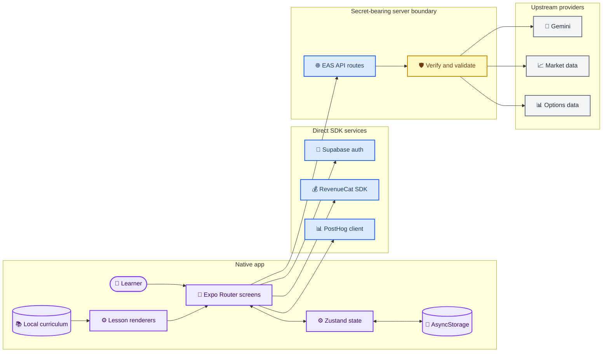

# Euphoria

**A finance-education iOS app for 18–25 year olds.** Twelve courses, three hundred lessons, a
paper-trading desk, a daily digest, and **Atlas** — the mascot who asks the onboarding questions and
answers the ones you ask back.

The teaching model is a *learning app's*, not a brokerage's: a streak, a daily goal, quests, a
league, and a pathway that unlocks as you go. That is a deliberate strategic choice backed by
evidence, not an aesthetic one — see [Peer group](#peer-group).

> ### Status: pre-release
> Not on the App Store. A five-image Goldie draft has been regenerated from the current Release
> simulator build and passes automated and human visual review. It remains a draft until source
> freeze because later user-facing changes require a fresh capture. Source gates pass,
> but the 300-lesson live-web/iOS evidence run and a sandbox purchase/restore are not complete.
> Treat [Known blockers](#known-blockers) and the canonical [task list](docs/status/TASKLIST.md) as
> submission gates, not aspirational status.

```text
PIPELINE ───────────────────────────────────────────────────────────────
Curriculum parity     [##--------] 01%   (2 lessons currently fully documented in-session)
iOS simulation flow   [#---------] 01%   (core lesson shells actively iterating)
Submission evidence   [----------] 00%   (Goldie/ASC/reviewer pre-checks still pending)
```

Current execution board: [LESSONS_PARITY_VISUAL_TASKLIST.md](docs/status/LESSONS_PARITY_VISUAL_TASKLIST.md)

---

## Contents

| | |
|---|---|
| **Orientation** | [What this is](#what-this-is) · [Peer group](#peer-group) · [Product facts](#product-facts) |
| **Engineering** | [Stack](#stack) · [Identifiers](#identifiers) · [Repository layout](#repository-layout) · [Architecture](#architecture) |
| **Running it** | [Getting started](#getting-started) · [Environment variables](#environment-variables) · [Deployment](#deployment) |
| **Quality** | [The gate](#the-gate) · [Verification philosophy](#verification-philosophy) · [Driving the simulator](#driving-the-simulator) · [App Store assets](#app-store-assets) |
| **Domain** | [Curriculum pipeline](#curriculum-pipeline) · [Monetisation and entitlement](#monetisation-and-entitlement) · [Analytics and privacy](#analytics-and-privacy) · [Security](#security) |
| **Process** | [Where the reasoning lives](#where-the-reasoning-lives) · [House rules](#house-rules) · [Commit conventions](#commit-conventions) |
| **Reference** | [Traps that have cost real time](#traps-that-have-cost-real-time) · [Known blockers](#known-blockers) · [Open work](#open-work) |
| **Also** | [CHANGELOG.md](CHANGELOG.md) · [refs/SECURITY_REVIEW.md](refs/SECURITY_REVIEW.md) · [AGENTS.md](AGENTS.md) |

---

## What this is

Euphoria teaches personal finance and investing to people who have never done either, using the
mechanics that actually retain learners rather than the ones a finance app is expected to have.

- **Twelve courses, 25 lessons each.** Investing fundamentals, personal finance, global economics,
  corporate finance, business strategy, financial analytics, behavioural finance, applied
  accounting, quantitative analysis, risk management, alternative investments, wealth management.
- **A paper-trading desk.** $10,000 of fake money — not the six-figure fantasy balance trading apps
  hand out, because a beginner learns more from sizing a position against a plausible first
  portfolio.
- **A daily digest.** 35 written guides, each mapped to the lessons that explain it.
- **Atlas.** An SVG mascot with nine expressions who runs onboarding and answers questions through a
  server-side Gemini proxy. He is explicitly forbidden from recommending securities, and that
  prohibition is enforced in code, not just in a prompt.
- **A widget**, a league, streaks, quests, and free-stock reward cards that pay learning into the
  thing you trade with.

### Peer group

Measured against ScreensDesign's dataset, Euphoria's design-mechanism competitors are **learning
apps — Duolingo, Babbel, Quizlet** — not brokerages, despite the App Store category. Of the top ten
apps at $500k/mo+ in the comparator pull, **nine were Education and one was Finance.**

Compare screens against those, not against Robinhood. Zogo, Stash, Greenlight and NGPF are **not in
the dataset**; say "no strong match" rather than substituting something off-topic.

### Product facts

| | |
|---|---|
| Trial | **3 days** (`TRIAL_DAYS`), counted in *distinct days of real use*, not elapsed time |
| Pricing | **$9.99/mo**, **$79.99/yr** — $6.67/mo, 33% off, deliberately under the ~$7.90 peer median |
| Curriculum | 12 courses × 25 lessons = **300 lessons**, 60 unit names, 35 digest guides |
| Content during trial | **Unmetered.** Every lesson, every guide — 4/4 reference trials grant full access |
| After the trial | A **hard wall** on content; the streak/XP/league loop stays open |
| Screen | 402 × 874 pt |
| Codebase | 39 route files · 59 top-level components · 62 top-level lib modules · 118 top-level scripts |
| History | **888 commits** through baseline `2b2408e` (run `git rev-list --count HEAD` for the live count) |

---

## Stack

| Layer | Choice |
|---|---|
| Runtime | Expo SDK `~57.0.7`, React Native `0.86.0`, React `19.2.3` |
| Routing | `expo-router` `~57.0.7` — file-based, 39 route files under `src/app` |
| Language | TypeScript `~6.0.3`, strict |
| State | `zustand` `^5.0.14`, persisted to `AsyncStorage` under `euphoria-app-state` |
| Motion | `react-native-reanimated` `4.5.0` |
| Billing | `react-native-purchases` `^10.7.0` (RevenueCat) |
| Analytics | `posthog-react-native` `^4.62.0` — funnel only, no autocapture, no session replay |
| Drawing | `react-native-svg` `15.15.4` — Atlas is SVG, not an image |
| Server | Expo Router API routes (`+api.ts`) on **EAS Hosting**, i.e. Cloudflare Workers |
| LLM | Gemini `gemini-3.5-flash`, proxied server-side so the key never ships |

> **`web.output` must stay `"server"` in `app.json`.** With `"static"` the API routes are not
> emitted at all and every server feature silently disappears.

### Identifiers

These have been re-derived wrong more than once. They are settled.

- **Bundle id `com.euphoriainv.euphoria`** on iOS.
- **App Group `group.com.euphoriainv.euphoria`** — must match in `app.json`, `src/lib/widget.ts`
  *and* `targets/widget/index.swift`. If the three disagree the widget reads nothing, silently.
- `android.package` stays `com.euphoria.native` **on purpose**. Google Play is a separate listing
  nobody has audited.
- EAS project `@s-k-28/euphoria-native`; App Store Connect team `9SS423KXF5`.

---

## Repository layout

```
src/
  app/            39 route files. expo-router file-based; (tabs) is the signed-in shell
    api/          server routes — chat, market, options, and the _underscore helpers
    (tabs)/       home, learn, trade, digest, you
    digest/ stock/ settings/ explore/ games/
  components/     59 top-level components — Atlas, lesson renderers, sheets, charts, shared UI
  lib/            62 top-level modules — store, entitlement, auth, curriculum, analytics, and rules
  constants/      theme tokens: Spacing, Radius, FontSize. Never hardcode a number these own
  hooks/          useTheme and friends
  shared/motion/  SpringPressable, NumberRollup, RewardPop
scripts/          118 top-level files: gates, regressions, simulator drivers, parity, sync, release tooling
.argent/          reproducible Goldie screenshot flows
goldie/           App Store screenshot configuration and generated local assets
refs/             MASTER_PLAN.md, CARRYOVER.md, SECURITY_REVIEW.md, audit findings, store assets
targets/widget/   the iOS widget, in Swift
```

### The rule modules

A recurring pattern, six files deep. Each holds **one rule**, is **erasable-syntax-only**, and
imports nothing a Node script cannot follow — so its regression can import the *real* rule instead of
restating it.

| file | the rule | why it was extracted |
|---|---|---|
| `lib/cost-basis.ts` | average cost through buys, sells and grants | its copy drifted; the same fix had to be applied twice |
| `lib/portfolio-value.ts` | cash + shares at mark + contracts **at cost** | existed three times; two had already diverged, showing a permanent phantom loss |
| `lib/billing-retry.ts` | the 16-day retry window, and `ENTITLEMENT_ID` | the regression admitted in its own header that it restated the rule |
| `lib/day-keys.ts` | local day keys, Monday weeks, the streak rule | `store.ts` warned about `weekKey` drift, then defined `weekKey` where nothing could test it |
| `lib/trial-reward.ts` | when the 17c offer may fire | an untestable gate on a recurring discount |
| `lib/dismissal-offer.ts` | when the 17d offer may fire | the rule had one home and three doors that bypassed it |

**If a rule matters enough to have a regression, the regression imports the rule.** A second copy is
worse than none — it passes review while disagreeing with the code that runs.

### Other modules worth knowing before you edit

| file | why |
|---|---|
| `lib/entitlement.ts` | The **single** authority on trial/expired/pro. `tier()` orders pro first, so a payer never sees a countdown. |
| `lib/store.ts` | 780 lines. **Anything added to state must also go in `partialize`**, or it silently won't survive a restart. |
| `lib/purchases.ts` | The **only** writer of `isPro`, and only ever from a *successful* `customerInfo` read — a network failure must never revoke a paying member. |
| `lib/stocks.ts` | A hardcoded mock price table. **Prices never move**, which bounds what the Trade tab can teach. |
| `lib/people.ts` | **Fabricated, and says so.** The league races invented rivals. |
| `lib/server/limit.ts` | In-memory rate limiter. Per-isolate on Workers — a real limiter against one client, weak against a distributed one, and it says so. |

---

## Architecture

### Why there is a server at all

Everything else is on-device. The API routes exist for exactly one reason: **keys that must not ship
in the binary.** Anything inside the IPA is extractable, and an extracted key bills our account.



Six boundary modules under `src/lib/server/` are imported by the Expo Router API routes:

- **`limit.ts`** — fixed-window rate limiting, keyed on identity + scope. Runs *first*, before the
  key check and before parsing, so a bad request never spends quota.
- **`identity.ts`** — verifies a Supabase JWT server-side. Pins `alg: HS256`, requires `exp`, uses
  `crypto.subtle.verify`. **No code path reads claims from an unverified token.** Fails closed.
- **`entitlement.ts`** — verifies paid server features against RevenueCat when the server secret is
  configured; it never trusts the client-side `isPro` flag.
- **`validate.ts`** — validates every value that reaches an upstream URL against an **allowlist**, so an encoding
  trick nobody has thought of fails by default.
- **`advice.ts`** — checks Atlas's completion before it is returned, refusing individualised
  investment advice. Keys on a *directive plus a named security*, never on the word "buy" — the
  curriculum is about buying things.
- **`chain.ts`** — normalises delayed option-chain responses from Cboe, marketdata.app, and the
  Tradier fallback into the stable client contract.

### State and persistence

`zustand` + `persist`, one store, `AsyncStorage` under the key `euphoria-app-state`. `entitlement.ts`
reads it and nothing else, so the entitlement engine did not have to change shape to accept real
money.

The trial clock is `activeDays` — **distinct days of real use**, capped at `TRIAL_DAYS + 1` because
one day past the limit is all `tier()` needs to answer "expired".

---

## Getting started

**Prerequisites:** Node 24+, Xcode with an iOS simulator, `eas-cli`. `scripts/sim.sh doctor` checks
the rest (ffmpeg, idb, maestro, cliclick, Pillow, numpy).

```bash
npm install
npx expo run:ios         # build and install a dev client (needed — expo-blur is native)
npx expo start           # Metro on 8081
```

Expo Go is **not** sufficient: `expo-blur` and the widget are native modules.

### Environment variables

Two classes, and confusing them is the classic mistake.

| variable | where | why |
|---|---|---|
| `EXPO_PUBLIC_REVENUECAT_IOS_KEY` | `.env.local` | **Public by design.** A RevenueCat SDK key identifies the app; it authorises nothing a receipt would not already prove. Always `appl_…`. |
| `EXPO_PUBLIC_GOOGLE_IOS_CLIENT_ID` | `.env.local` | **Public.** It ships in the binary and in the URL scheme regardless. |
| `EXPO_PUBLIC_SUPABASE_URL` / `_ANON_KEY` | `.env.local` | **Public.** The anon key is protected by row-level security. *Not yet set.* |
| `EXPO_PUBLIC_POSTHOG_KEY` | `.env.local` | **Public.** `phc_…` project keys are client keys. *Not yet set.* |
| `GEMINI_API_KEY` | **EAS only** | Secret. Set 2026-08-13. |
| `POLYGON_API_KEY` · `ALPHAVANTAGE_API_KEY` · `TRADIER_TOKEN` | **EAS only** | Secret. *Not yet set.* |
| `SUPABASE_JWT_SECRET` | **EAS only** | Secret. Activates server-verified identity. *Not yet set.* |

> **Anything prefixed `EXPO_PUBLIC_` is inlined in plain text into the compiled app.** It must never
> hold a secret. Non-prefixed variables are reachable only from server routes.
>
> `.env.local` is gitignored (`.env*.local`), as are `*.p8`, `*.pem`, `.secrets/` and `dist/`.
> `.env.example` holds placeholders only.

---

## Deployment

**This sequence is exact, and each step is load-bearing.** Getting it wrong produces a *successful*
deploy serving `503 not_configured`, which reads as a bad key and sends you after the wrong problem.

```bash
# 1. create the variable (env:create — NOT env:set, which does not exist on eas-cli 21.7.1)
npx eas env:create --name GEMINI_API_KEY --value "<v>" \
    --environment production --visibility sensitive --scope project --non-interactive

# 2. export UNDER that environment. `env:exec` takes the environment POSITIONALLY.
npx eas env:exec production "npx expo export --platform web"

# 3. deploy and promote
npx eas deploy --prod --environment production --non-interactive

# 4. verify by reading the BODY. A successful deploy proves nothing about env.
curl -s -X POST https://euphoria-native.expo.app/api/chat \
  -H 'Content-Type: application/json' \
  -d '{"messages":[{"role":"user","content":"hello"}]}'

# 5. GET routes are EDGE-CACHED (`cache-status: EAS`). Without a cache-buster you are reading
#    the PREVIOUS deployment's answer — this cost real time twice (§22 C122).
curl -s "https://euphoria-native.expo.app/api/options?action=expirations&sym=AAPL&_cb=$(date +%s)"
```

**Step 2 is the one everybody skips.** The built server bundle contains `process.env.GEMINI_API_KEY`
as a *runtime* lookup, which makes it look as though export cannot matter — but the export is what
tells EAS Hosting which variables the deployment needs. A value absent at export time is absent from
the Worker no matter what the code does at runtime. Three deploys were lost to that inference
(§22 C119 → C120).

Production: **https://euphoria-native.expo.app**

---

## The gate

Nothing merges without these, in this order:

```bash
npx tsc --noEmit                       # must be clean
npm run check                          # 13 regression + pinning scripts, all must PASS
npx expo lint 2>&1 | grep problems     # 48 problems (3 errors, 45 warnings) — the accepted C66 baseline
python3 scripts/certify.py             # every route renders
node scripts/a11y-audit.mjs            # 1 "unlabelled" is a known docstring false positive
./scripts/sim.sh screen                # then LOOK AT THE REAL SCREEN
```

### What `npm run check` pins, and the failure each prevents

| script | the failure it prevents |
|---|---|
| `day-keys-regression` | a streak lost overnight — local-vs-UTC days, Sunday mapping back to Monday, the year boundary |
| `cost-basis-regression` | average cost surviving partial sells, grants and legacy state |
| `portfolio-snapshot-regression` | the chart and the headline valuing the same portfolio differently |
| `billing-retry-regression` | hard-walling a member mid card-retry, turning a recoverable decline into real churn |
| `lesson-preview-coverage` | lesson-intro previews silently disappearing (186 of 300 by design) |
| `unit-names-coverage` | course ids drifting so unit headers stop rendering (60 names, 12 courses) |
| `check-digest-lessons` | digest guides pointing at lessons that no longer exist |
| `trial-reward-regression` | the 17c offer firing to a payer, after expiry, or twice per install |
| `dismissal-offer-regression` | the 17d offer — and *structurally*, that every trial-expired wall consults it |
| `api-validation-regression` | a crafted ticker walking out of the intended upstream endpoint on our paid key |
| `identity-regression` | a forged or expired token being believed — `alg: none`, algorithm confusion, tampered payloads |
| `advice-guard-regression` | Atlas recommending a security — and the reverse, the guard eating the curriculum |
| `privacy-claim-pin` | `why-not-free.tsx` making a claim the code no longer honours |

### Verification philosophy

Three rules, each bought with a real defect.

**§22 C109 — LOOK AT THE SCREEN.** The accessibility tree tells you what *exists*, never what a tap
will *do*.

**§22 C113 — a green gate means the things it checks are fine. It does not mean the number on the
screen is true.** Four green runs once sat over a Trade tab rendering `+300.0%` on a position that
had not moved. **For anything computing a number a user reads as their own money, get a second
reader.**

**A checker that has never failed has not been tested.** Every regression here was verified against
the break it exists to catch, not merely observed to pass. Several caught real bugs that way — a
truthiness check reading epoch 0 as "unseen", a `<` that lost the last granted day of the trial.

---

## Driving the simulator

`scripts/sim.sh` answers in **text**, not screenshots, because reading images costs real money.

```bash
export EUPHORIA_UDID=<udid>            # "Euphoria QA"; otherwise the first booted sim is used
./scripts/sim.sh doctor                # verify the toolchain
./scripts/sim.sh screen                # the accessibility tree as "label @ x,y", in POINTS
./scripts/sim.sh tapon "Start"         # tap by label, no coordinates
./scripts/sim.sh tap <x> <y>           # tap a point
./scripts/sim.sh state '{isPro}'       # the persisted zustand store, as JSON
./scripts/sim.sh open "onboarding?step=paywall"
./scripts/sim.sh motion "<label>" [s]  # tap, then measure whether the mascot TRANSLATED
./scripts/seed-trial.sh 4 false        # expired trial;  0 true = pro
./scripts/capture-screens.sh           # re-shoot all 31 routes
```

`seed-trial.sh` writes the persisted store directly and relaunches, rather than exposing a debug
route — a debug screen a user could reach is a dead control (§0.5).

---

## App Store assets

Store screenshots are generated from the real Release simulator build with
[Goldie](https://github.com/kacperkapusciak/goldie), not assembled from mock screens. Argent replays
the five checked-in flows under `.argent/flows/`; `goldie/goldie.config.ts` supplies the device,
copy, frame and layouts; finished English 6.9-inch assets land under
`goldie/out/screenshots/6.9/en-US/`.

```bash
npx --yes goldie doctor --config goldie/goldie.config.ts
npx --yes goldie all --config goldie/goldie.config.ts
```

`doctor` must identify a **Release** `.app`, the intended simulator and every flow before capture.
`all` captures, frames and verifies the full set. A passing pixel-size check is necessary but not
sufficient: visually review every result for stale UI, test data, safe-area errors and copy before
upload. Apple currently allows one to ten screenshots and can scale the highest-resolution set to
smaller devices; the authoritative upload workflow and accepted states live in
[App Store Connect Help](https://developer.apple.com/help/app-store-connect/manage-app-information/upload-app-previews-and-screenshots/).

Generated output is evidence from the build named by `appPath`. Rebuild that Release app after any
user-facing source change; otherwise Goldie will faithfully produce polished screenshots of stale
UI. Debug builds are never acceptable because development banners can become part of the image.

---

## Curriculum pipeline

Content is authored in the **web repo** (`~/euphoriaweb-current`) and synced in:

```bash
./scripts/sync-curriculum.sh     # courses → src/lib/curriculum/courses/*.ts
./scripts/sync-digest.sh         # guides  → src/lib/digest-bodies.ts
```

The generated course files are large (0.5–1.2 MB each) and **must not be hand-edited** — the next
sync overwrites them. Three regressions guard the seams: `unit-names-coverage` (ids still resolve),
`lesson-preview-coverage` (previews still render), `check-digest-lessons` (guides still point at
real lessons).

---

## Monetisation and entitlement

One authority, one writer, three surfaces.

- **`entitlement.ts::tier()`** answers `trial | expired | pro`, ordering **pro first** so a paying
  member never sees a countdown. That specific bug is what generates "I already paid" support mail.
- **`purchases.ts`** is the *only* thing that may set `isPro`, and only from a successful RevenueCat
  read. Offline never revokes access.
- **Billing retry (17e)** — a member whose card is mid-retry keeps access for 16 days. 20–40% of
  subscription churn is failed payments, not intent; locking those people out is what makes them
  stop trying to fix it.

### The two offers

| | 17c — trial reward | 17d — dismissal offer |
|---|---|---|
| Fires | on the **first lesson finished** inside the trial | on **dismissal** of a trial-expired wall |
| Framing | "You've earned something" | "Before you go — one better offer" |
| Once per install | yes (`trialRewardSeenAt`) | yes (`specialOfferSeenAt`) |
| Evidence | Headway `128596`, **1/5 — a bet, not convergence** | Translator GO, Yazio, StressWatch, Numify — 4/4 of those checked |

Neither shows a **price or a percentage**. C31 locks annual at $79.99, the discounted product does
not exist in App Store Connect, and a figure no store can charge is exactly what §0.4 forbids. The
real number belongs on the plan screen, from the RevenueCat package.

---

## Analytics and privacy

`why-not-free.tsx` makes four factual claims to the user. All four are enforced in code and pinned by
`privacy-claim-pin`:

- **No ad SDK** — a dependency-tree fact.
- **No data sale** — nothing is shared.
- **No session replay** — `enableSessionReplay: false`, configured not assumed.
- **Nothing that identifies you personally** — the identity is `installId`, never name, handle or
  email. All event properties are checked for PII shapes.

**Autocapture is off by *omission*, not by a flag** — PostHog only autocaptures through
`<PostHogProvider autocapture>`, and this app constructs the client directly. Wrapping the app in
that Provider would silently make shipped copy false, so the pin fails if one appears without
`autocapture={false}`.

---

## Security

Full findings, sources and the remaining plan: **[refs/SECURITY_REVIEW.md](refs/SECURITY_REVIEW.md)**
— eight findings from a 2026-08-13 pass, five closed.

Closed: unbounded LLM consumption; unvalidated tickers reaching upstream URLs; our API key stapled to
a URL from upstream data; prompt-injection into Atlas; unverified caller identity.

Open: the limiter is per-isolate (`F6`); no route checks entitlement, so `/api/chat` spends real
tokens for anyone with the URL (`F7`); social sign-in is unverified on-device — harmless today,
an authentication bypass the day it is wired to a server (`F8`).

---

## Where the reasoning lives

This repo keeps its decisions, not just its code. In order of authority:

1. **`refs/MASTER_PLAN.md` §22 — the corrections log, `C1`…`C120`.** Every entry records something
   that was got wrong and what is true instead. Commit messages cite these by number. **A commit
   body wins over the reconstruction where they disagree.**
2. **`CARRYOVER.md`** — the session handoff, written to be pasted whole into a fresh session.
   **Verify it against the repo before trusting a count.** It has twice claimed a §22 range that did
   not exist, and its `eas env:set` instruction is wrong.
3. **`refs/SECURITY_REVIEW.md`** — the security pass and what remains.
4. **`AGENTS.md`** — the rules for working here, chiefly that ScreensDesign is mandatory for design
   work and that you read the **screen**, never the flow description.
5. **`CHANGELOG.md`** — every commit, generated by `scripts/gen-changelog.py`. It runs through
   `rtk proxy` because the token-filtering git wrapper truncates log output at ~50 entries even when
   redirected to a file.

### House rules

Not negotiable, and each is load-bearing:

- **§0.4 — never show a number the app cannot back.** No invented prices, no percentages without a
  product behind them, no "offer ends soon" without a timer.
- **§0.5 — no dead controls.** A button that cannot do its job is disabled *with its reason on
  screen*, not hopeful.
- **§0.7 — never invent product copy.** Draft options, let the owner choose. Files carry a
  `COPY IS UNAPPROVED` marker until they do.
- **§16a** — discount framing may not appear in any App Store asset.
- **§20.1 / §20.2** — one refusal reason at a time; copy decks live with the component.

### Commit conventions

Conventional Commits (`feat`, `fix`, `docs`, `test`, `refactor`, `audit`, `copy`, `a11y`), scoped
where it helps (`feat(17c):`). Bodies are expected to explain **why**, cite `C` numbers, and record
what was *not* done. The history is 888 commits through `2b2408e`; earlier commits predate the
convention and use `Area: subject`. Derive the current number with `git rev-list --count HEAD`
instead of copying this baseline into release notes.

---

## Traps that have cost real time

Every one of these was discovered the expensive way.

**The accessibility tree does not model overlays.** LogBox's error bar sits at **y≈795–811pt**,
directly over some dismiss controls and the lesson-intro `Continue`. `sim.sh` will report tapping a
button that is physically covered and nothing happens — it once absorbed **52 consecutive taps**.
Dismiss LogBox before driving anything.

**A MultiSelect row's centre is not its checkbox.** The toggle is on the left; tapping the middle of
a three-line row lands on dead space.

**MultiSelect will not advance on a wrong answer**, so an automated driver needs the answer key out
of `curriculum/courses/*.ts`, not persistence.

**`gh auth` reverts between pushes.** The active account returns to `s-k-28`, which cannot see the
repo and fails with a bare "Repository not found". Run
`gh auth switch --user teameuphoriainv-dot` **before every push**.

**Listed is not usable.** `gemini-2.5-flash` appears in `/v1beta/models` and returns
`404 "no longer available to new users"` on `generateContent`. Only a call reveals it, and the route
used to flatten that into a generic `502`.

**Gemini keys are not always `AIza…`.** The working key here is `AQ.…`, 53 characters. **Do not add
an `AIza` shape gate** — it would reject a valid credential.

**`eas env:set` does not exist** on eas-cli 21.7.1. It is `env:create`. And `env:exec` takes the
environment **positionally**, not as `--environment`.

**The simulator shuts itself down unprompted.** Run `xcrun simctl list devices` before theorising
about a crash.

**Metro's dev server does not rate-limit.** It re-evaluates route modules per request, recreating the
limiter's buckets empty every time. Verify limits against an exported bundle, never `:8081`.

---

## Known blockers

These are evidence gaps, not promises that the underlying feature is broken. Dashboard/account
state changes faster than source, so verify it at submission time instead of preserving a stale
claim in this README.

| gate | evidence required before submission |
|---|---|
| **Release candidate** | Clean Release build from the final source; TypeScript, `npm run check`, export and cold-launch checks passing |
| **Lesson parity** | Accepted live-web and native recordings plus a screen-by-screen verdict for each of all 300 lessons |
| **Subscriptions** | One successful sandbox purchase and restore; products attached to the same app submission; review screenshot and notes |
| **Reviewer access** | Working demo credentials and a repeatable reviewer path through onboarding, paywall and lessons |
| **Store creative** | Goldie assets regenerated from the final Release build and visually reviewed after its automated size verification |
| **Accessibility** | Small-screen, maximum Dynamic Type, VoiceOver, Reduced Motion and contrast evidence on the release candidate |
| **Operations** | Production exception capture, alert routing, rollback/source-map procedure and the available backup/restore posture documented |

Only the **Account Holder** should accept agreements or change legal/compliance status in App Store
Connect. Source work can prepare the evidence; it cannot substitute for those account actions.

---

## Open work

- **300-lesson evidence run.** The corpus and render-path audits prove inventory and reachability;
  they do not replace the per-lesson live web/native recordings and adjudications. Current
  reachability evidence accounts for all 1,321 animated visuals, all 11 authored raw SVGs, all 289
  interactive graphs, and all 665 graph controls. The dedicated hook renderer also preserves the
  web-timed title/visual/outcome staging and inline `Begin` CTA across all 300 lessons; Release
  inspection confirms the path, while live-web adjudication remains outstanding.
- **Release-candidate screenshots.** The current-Release five-image draft passes Goldie capture,
  framing, size verification and human review. Rebuild and replay the flows after source freeze,
  then review the final narrative before treating the verified PNGs as uploadable.
- **Commerce and review path.** Finish sandbox purchase/restore, attach the subscriptions to the
  app submission, supply review notes/screenshots, and verify the reviewer identity from a cold
  install.
- **Full-app qualification.** Finish role-based auth, poor/offline network, accessibility and
  operational recovery evidence from `docs/status/TASKLIST.md`.
- **Known synthetic data.** `lib/people.ts` intentionally supplies fabricated league rivals; keep
  that boundary explicit until a real social graph replaces it.

---

<div align="center">

**Private repository.** © Euphoria.

[Changelog](CHANGELOG.md) · [Security review](refs/SECURITY_REVIEW.md) · [Working rules](AGENTS.md)

</div>
