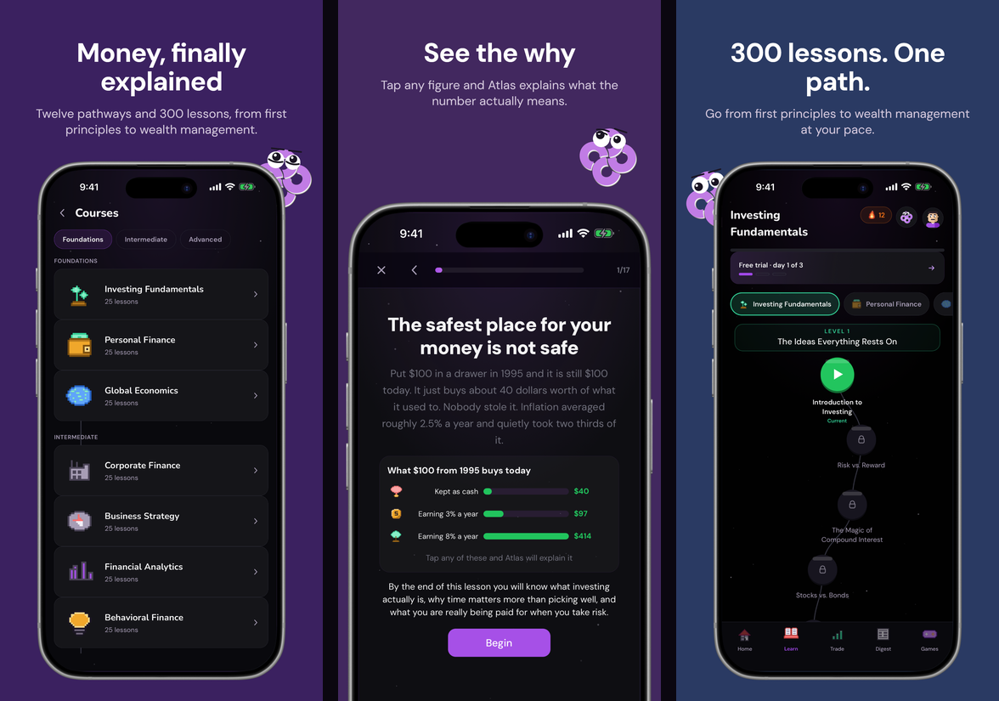
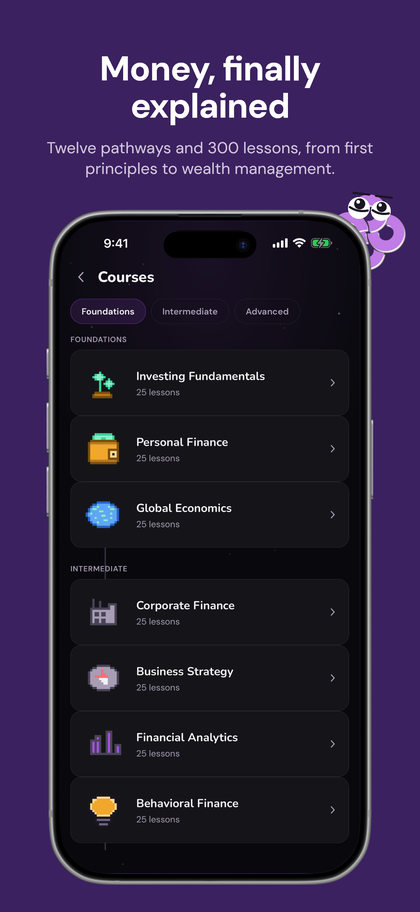
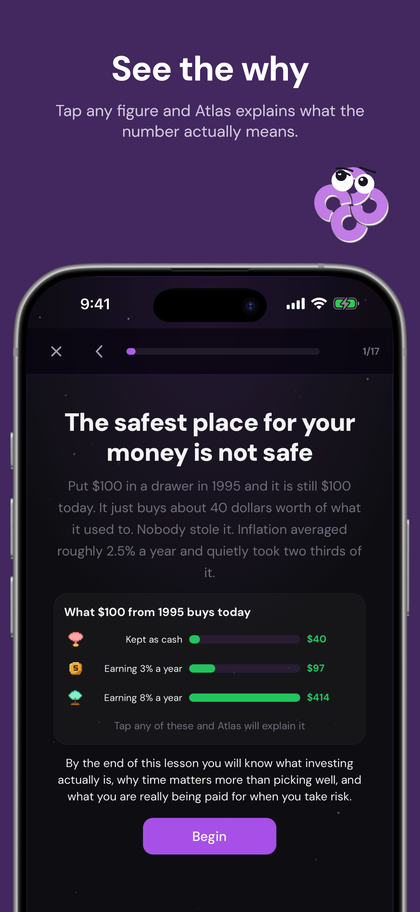
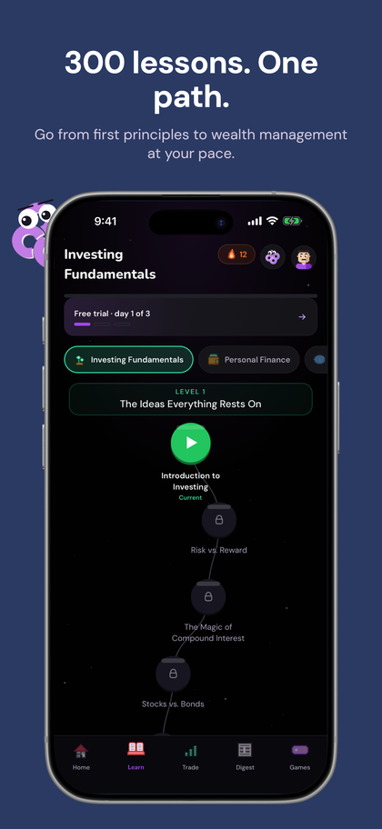
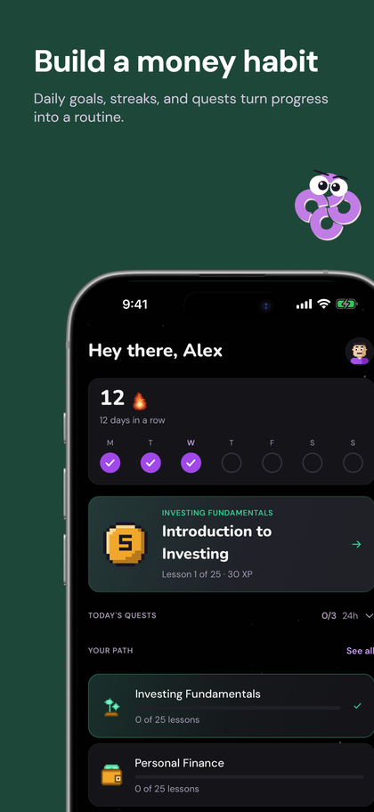
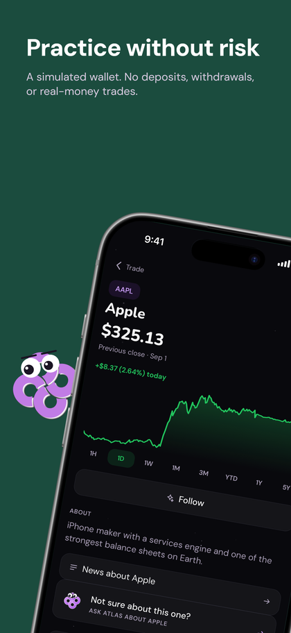
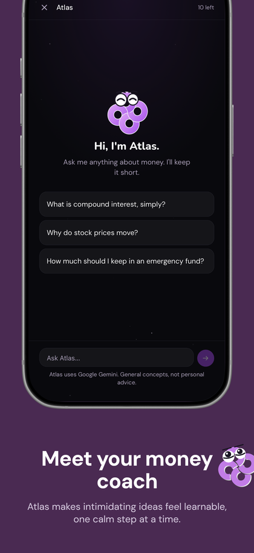

```
 ███████╗██╗   ██╗██████╗ ██╗  ██╗ ██████╗ ██████╗ ██╗ █████╗
 ██╔════╝██║   ██║██╔══██╗██║  ██║██╔═══██╗██╔══██╗██║██╔══██╗
 █████╗  ██║   ██║██████╔╝███████║██║   ██║██████╔╝██║███████║
 ██╔══╝  ██║   ██║██╔═══╝ ██╔══██║██║   ██║██╔══██╗██║██╔══██║
 ███████╗╚██████╔╝██║     ██║  ██║╚██████╔╝██║  ██║██║██║  ██║
 ╚══════╝ ╚═════╝ ╚═╝     ╚═╝  ╚═╝ ╚═════╝ ╚═╝  ╚═╝╚═╝╚═╝  ╚═╝
```

<p align="center">
  
  
  
  
  
  
</p>

<p align="center">
  
</p>

<p align="center">
  <em>Twelve pathways · 300 lessons · a simulated trading desk · and Atlas, who explains every number.</em>
</p>

**A finance-education iOS app for 18 to 25 year olds.** Twelve courses, three hundred lessons, a
paper-trading desk, a daily digest, and **Atlas**, the mascot who runs onboarding and answers the
questions you ask back.

The teaching model is a learning app's, not a brokerage's: a streak, a daily goal, quests, and a
pathway that unlocks as you go. Measured against ScreensDesign's dataset, the design-mechanism
competitors are Duolingo, Babbel and Quizlet rather than Robinhood. Of the top ten apps at
$500k/mo or more in the comparator pull, nine were Education and one was Finance. Compare screens
against those.

A companion web app at `euphoriainv.com` serves the identical curriculum, and the two are kept in
provable lockstep. See [Curriculum and parity](#curriculum-parity).

## Screens

Captured from the shipping build with `npm run screenshots:store`, not mocked. These are the six
tiles on the App Store listing.

| | | |
|:--:|:--:|:--:|
| <br>**Money, finally explained**<br><sub>Twelve pathways, 300 lessons</sub> | <br>**See the why**<br><sub>Tap any figure, Atlas explains it</sub> | <br>**300 lessons. One path.**<br><sub>First principles to wealth management</sub> |
| <br>**Build a money habit**<br><sub>Daily goals, streaks, quests</sub> | <br>**Practice without risk**<br><sub>Live market data, virtual cash</sub> | <br>**Meet your money coach**<br><sub>Atlas, on every screen</sub> |

## What it is

**Prerequisites:** Node 24 or newer, Xcode with an iOS simulator, `eas-cli`.
`scripts/sim.sh doctor` checks the rest (ffmpeg, idb, maestro, cliclick, Pillow, numpy).

```bash
npm install
npx expo run:ios     # builds and installs a dev client
npx expo start       # Metro on 8081
```

> **Expo Go will not work.** `expo-blur` and the widget are native modules, so you need the dev
> client that `expo run:ios` builds. This is the single most common way to lose an hour here.

The app runs with no API keys at all. Every key is optional and the app says on screen what is
switched off rather than showing invented data. See [Environment](#environment).

| | |
|---|---|
| **Contents** | [Product facts](#product-facts) · [Layout](#repository-layout) · [Architecture](#architecture) · [Environment](#environment) |
| | [Curriculum and parity](#curriculum-parity) · [Quality gates](#what-each-gate-runs) · [Deployment](#deploying-the-api-routes) |
| | [Traps](#traps-that-have-cost-real-time) · [Known open items](#known-issues-and-traps) |

## By the numbers

Every figure below is produced by a script in this repo, not typed by hand. `npm run
parity:structure` walks the curriculum and compares it screen-for-screen against the web app; the
counts here come from that same walk.

| | |
|---|---|
| Courses | **12** |
| Lessons | **300** — 25 per course, exactly |
| Authored screens | **4,050** |
| Mastery-challenge screens | **1,770** |
| Total runtime screens | **5,820** (4,050 + 1,770, derived) |
| Curriculum parity with web | **12/12 courses SHA-256 identical** |
| Structural parity | **4,050 / 4,050 screens match by index and kind** |
| Quality gate | **57 checks** in `npm run check` |

```text
SCREENS PER COURSE            25 lessons each · 4,050 total

Alternative Investments ██████████████████████████████████  396
Quantitative Analysis   ████████████████████████████████░░  374
Wealth Management       ████████████████████████████████░░  372
Investing Fundamentals  ███████████████████████████████░░░  363
Applied Accounting      ███████████████████████████████░░░  362
Personal Finance        ██████████████████████████████░░░░  352
Risk Management         █████████████████████████████░░░░░  341
Behavioral Finance      █████████████████████████████░░░░░  333
Global Economics        ████████████████████████████░░░░░░  329
Business Strategy       ██████████████████████████░░░░░░░░  305
Corporate Finance       ███████████████████████░░░░░░░░░░░  263
Financial Analytics     ██████████████████████░░░░░░░░░░░░  260
```

Alternative Investments carries the most screens and Financial Analytics the fewest — a 136-screen
spread across courses that all hold exactly 25 lessons. Density is a function of how much a topic
needs shown rather than told.

```text
SCREEN KINDS                  what a learner actually does

quiz              ██████████████████████████████  441  10.9%
teachingSlide     █████████████████████████████░  432  10.7%
microCheck        █████████████████████░░░░░░░░░  312   7.7%
hookOpener        ████████████████████░░░░░░░░░░  300   7.4%
stakesCard        ████████████████████░░░░░░░░░░  300   7.4%
interactiveGraph  ████████████████████░░░░░░░░░░  289   7.1%
fillBlank         ███████████████████░░░░░░░░░░░  281   6.9%
trueFalse         ███████████████████░░░░░░░░░░░  273   6.7%
scenario          ███████████████████░░░░░░░░░░░  273   6.7%
tapReveal         █████████████████░░░░░░░░░░░░░  248   6.1%
dragSort          ████████████████░░░░░░░░░░░░░░  231   5.7%
match             ██████████████░░░░░░░░░░░░░░░░  201   5.0%
slider            ██████████████░░░░░░░░░░░░░░░░  199   4.9%
keyTermsCards     █████████████░░░░░░░░░░░░░░░░░  186   4.6%
progressiveCalc   ███░░░░░░░░░░░░░░░░░░░░░░░░░░░   44   1.1%
buildIt           ██░░░░░░░░░░░░░░░░░░░░░░░░░░░░   29   0.7%
explorable        █░░░░░░░░░░░░░░░░░░░░░░░░░░░░░    4   0.1%
calculator        █░░░░░░░░░░░░░░░░░░░░░░░░░░░░░    4   0.1%
concept           █░░░░░░░░░░░░░░░░░░░░░░░░░░░░░    2   0.0%
decisionTree      █░░░░░░░░░░░░░░░░░░░░░░░░░░░░░    1   0.0%
```

The long tail is deliberate. `decisionTree` appears once and `concept` twice; they exist because a
specific lesson needed them, not because the format was worth generalising. The top five kinds
carry 44% of the curriculum.

### Product facts

| | |
|---|---|
| Trial | **3 days** (`TRIAL_DAYS`, `src/lib/store.ts`), counted in distinct days of real use, not elapsed time |
| Pricing | **$9.99/mo**, **$79.99/yr**, which is $6.67/mo and 33% off |
| Curriculum | 12 courses of 25 lessons, so **300 lessons**, all twelve currently available |
| Content during trial | Unmetered. Every lesson, every guide |
| After the trial | A hard wall on content. The streak, XP and league loop stays open |
| Screen | 402 x 874 pt |

**Identifiers.** Bundle id `com.euphoriainv.euphoria`. App Group `group.com.euphoriainv.euphoria`,
which must agree across `app.json`, `src/lib/widget.ts` and `targets/widget/index.swift` or the
widget silently reads nothing. `android.package` is the distinct `com.euphoria.native`, a separate
and unaudited Play listing. EAS project `@s-k-28/euphoria-native`. Apple team `9SS423KXF5`.
App Store Connect app `6761808087`.

## Architecture

Everything except the three `+api.ts` routes runs on-device: local curriculum data, Zustand state
persisted to `AsyncStorage`, and direct SDK calls to Supabase (auth), RevenueCat (billing) and
PostHog (analytics, funnel only).

**Why there is a server at all.** Exactly one reason: provider keys that would otherwise ship
inside the IPA and be extractable. The routes run as Expo Router API routes on **EAS Hosting**,
which is Cloudflare Workers. `web.output` must stay `"server"` in `app.json`, because `"static"`
drops the API routes entirely and does it with no error.

**Stack**, read from `package.json` and `app.json`: Expo SDK `~57.0.18`, React Native `0.86.3`,
React `19.2.3`, TypeScript `~6.0.3` (strict), `expo-router`, `zustand`, `react-native-reanimated`,
`react-native-purchases` (RevenueCat), `posthog-react-native`, `react-native-svg` for Atlas, and
`gemini-3.5-flash` behind the chat route. That model is **pinned, not `gemini-flash-latest`**: the
alias would survive a retirement but also moves the model under a system prompt and an advice guard
tuned against a known one, and a silent capability change on a finance app aimed at 18 to 25s is
the worse failure.

```text
┌─ src/app ─────────────────── 42 files · 15,427 lines ──────────────────────┐
│  expo-router file routes. (tabs)/ home learn trade digest games,           │
│  plus lesson.tsx (1,205) and onboarding.tsx (1,180) — the two              │
│  screens that carry the product.                                          │
│                                                                            │
│  api/  market+api.ts · chat+api.ts · options+api.ts                       │
│        Expo API routes, deployed to EAS Hosting, NOT bundled in the app.   │
└────────────────────────────┬───────────────────────────────────────────────┘
                             │
┌─ src/components ──────────── 77 files · 14,545 lines ──────────────────────┐
│  One component per step kind: matching-pairs, order-steps, multi-select,   │
│  stakes-card, interactive-graph… The lesson runner dispatches on           │
│  `normalizeStep().kind` and never on raw authored shape.                   │
└────────────────────────────┬───────────────────────────────────────────────┘
                             │
┌─ src/lib ─────────────────── 111 files · 91,041 lines ─────────────────────┐
│  curriculum/   73,545 lines — 12 course files, the product's real mass     │
│  store.ts       1,377 lines — zustand + persist. See the warning below.    │
│  lesson-steps.ts  733      — normalizeStep(): authored data → render kind  │
│  purchases.ts     376      — RevenueCat, entitlement "Euphoria Pro"        │
│  auth.ts          356      — Supabase session, delete_own_account          │
│  server/                   — advice · chain · entitlement · identity ·     │
│                              limit · validate. Guards that must NOT be     │
│                              client-side: the buy/sell advice block lives  │
│                              here because a client check is a suggestion.  │
└────────────────────────────────────────────────────────────────────────────┘
```

**The curriculum is 80% of `src/lib` by line count.** Treat it as data, not code: 12 course
files, 300 lessons, 4,050 authored screens. Nothing in it should import from `src/app`.

**`normalizeStep()` is the seam.** Authored lessons are terse and occasionally irregular; the
renderer must never see that. Every step passes through `normalizeStep()` in `lesson-steps.ts`,
which returns a discriminated `kind`, and `lesson.tsx` dispatches on that alone. When a lesson
renders wrongly the bug is almost always in the normaliser, not the component.

**`store.ts` has one rule that will bite you.** State is persisted through zustand's `persist`
middleware with an explicit `partialize`. Anything you add to state and *not* to `partialize` is
silently session-only — it will work perfectly in development and lose the user's data on
relaunch. The file documents which omissions are deliberate (the perf HUD, hydration status) and
why.

**Server guards are server-side on purpose.** `src/lib/server/advice.ts` blocks individualised
buy/sell recommendations from Atlas. That check cannot move to the client: the App Review notes
promise Apple it exists, and a client-side guard is a suggestion, not a guarantee.

---

### Repository layout

```
src/
  app/            42 files, expo-router file-based routing
    api/          chat+api.ts, market+api.ts, options+api.ts, the only server code in the app
    (tabs)/       home, learn, trade, digest, games, the signed-in shell
    digest/ stock/ settings/ explore/ games/
                  you.tsx lives at the top level, NOT in (tabs): profile is a place you
                  visit, not a thing you do, and five tab slots is the practical maximum
  components/     77 files (72 at the top level), Atlas, lesson renderers, sheets, charts, UI
  lib/            111 files (73 at the top level), store, entitlement, auth, curriculum, analytics
    server/       code that runs inside the API routes (rate limiting, provider calls)
  constants/      theme.ts, lesson-design.ts, spacing/radius/font tokens
  hooks/          use-theme.ts, use-mastery-hints.ts
  shared/motion/  spring-pressable, number-rollup, reward-pop, sheet-entrance, step-transition
scripts/          176 files (148 at the top level), regressions, pins, parity checks, simulator
                  drivers, curriculum/digest sync, release tooling (anim/, parity/, rive/ subdirs)
targets/widget/   the iOS widget: Info.plist, expo-target.config.js, index.swift
docs/status/      the living status record this README's claims are drawn from
refs/             submission history, shipping notes, planning documents
goldie/           App Store screenshot capture configuration
```

### Modules to read before you edit

Six single-purpose files in `src/lib/`, each holding one rule that used to be duplicated:

| File | The rule |
|---|---|
| `lib/cost-basis.ts` | average cost through buys, sells and grants |
| `lib/portfolio-value.ts` | cash + shares at mark + contracts at cost |
| `lib/billing-retry.ts` | `ENTITLEMENT_ID = 'Euphoria Pro'` and a 16-day billing-retry grace window |
| `lib/day-keys.ts` | local day keys, Monday weeks, the streak rule |
| `lib/trial-reward.ts` | when a discounted-offer trial reward may fire |
| `lib/dismissal-offer.ts` | when a dismissal offer may fire |

And four more worth knowing:

- **`lib/entitlement.ts`** is the single authority on trial/expired/pro state. `tier()` orders pro
  first, so a payer never sees a countdown.
- **`lib/store.ts`** is 1,377 lines, and anything added to its state must also be added to
  `partialize` or it will not survive a restart. The file says so in its own header.
- **`lib/purchases.ts`** is the only writer of `isPro`, and only from a successful `customerInfo`
  read, so a network failure can never revoke a paying member.
- **`lib/server/limit.ts`** is an in-memory rate limiter, per-isolate on Cloudflare Workers. Its own
  comments say it is weak against a distributed client.

## Getting started

```bash
npm install
npm run ios          # builds and installs the dev client, then starts Metro
```

Node 24+, Xcode with an iOS simulator, and `eas-cli`. Expo SDK 57, React Native 0.86,
expo-router 57, zustand 5, Reanimated 4.5, Skia 2.6, Supabase JS 2.112.

The three failure modes that cost the most time here are in [Traps that have cost real time](#traps-that-have-cost-real-time).

### Environment

Two classes, and confusing them is the classic mistake.

| Variable | Where | Why |
|---|---|---|
| `EXPO_PUBLIC_REVENUECAT_IOS_KEY` | `.env.local` | Public by design. A RevenueCat SDK key identifies the app; it authorises nothing a receipt would not already prove |
| `EXPO_PUBLIC_GOOGLE_IOS_CLIENT_ID` | `.env.local` | Public. It ships in the binary and the URL scheme regardless |
| `EXPO_PUBLIC_SUPABASE_URL` / `_ANON_KEY` | `.env.local` | Public. The anon key is protected by row-level security. Both are required together |
| `EXPO_PUBLIC_POSTHOG_KEY` | `.env.local` | Public. `phc_` project keys are client keys |
| `GEMINI_API_KEY` | **EAS only** | Secret |
| `POLYGON_API_KEY` · `ALPHAVANTAGE_API_KEY` · `TRADIER_TOKEN` | **EAS only** | Secret |
| `SUPABASE_JWT_SECRET` | **EAS only** | Secret. Activates server-verified identity |

> **Anything prefixed `EXPO_PUBLIC_` is inlined in plain text into the compiled app.** It must never
> hold a secret. Non-prefixed variables are reachable only from server routes.

`.env.local` is gitignored, as are `*.p8`, `*.pem`, `.secrets/` and `dist/`. `.env.example` holds
placeholders only and is the authoritative list, so read it rather than trusting this table.

## Build and release

| Profile | Distribution | Channel | Notes |
|---|---|---|---|
| `development` | internal | development | dev client, for daily work |
| `development-simulator` | internal | development | dev client, simulator target |
| `preview` | internal | preview | internal testing |
| `production` | store | production | App Store submissions |

**Before submitting, run the two gates that exist for it:**

```bash
npm run asc:preflight     # 29 live checks against App Store Connect
npm run test:reviewer     # 5 Maestro flows on a simulator
```

`scripts/asc-submit.mjs` refuses to run without preflight passing. The full submission runbook,
including the traps that have already cost a rejection, is in
[docs/status/APP_STORE_SUBMISSION.md](docs/status/APP_STORE_SUBMISSION.md).

### Deploying the API routes

**This sequence is exact and each step is load-bearing.** Getting it wrong produces a *successful*
deploy serving `503 not_configured`, which reads as a bad key and sends you after the wrong problem.

```bash
# 1. create the variable. env:create, NOT env:set, which does not exist on eas-cli 21.7.1
npx eas env:create --name GEMINI_API_KEY --value "<v>" \
    --environment production --visibility sensitive --scope project --non-interactive

# 2. export UNDER that environment. env:exec takes the environment POSITIONALLY
npx eas env:exec production "npx expo export --platform web"

# 3. deploy and promote
npx eas deploy --prod --environment production --non-interactive

# 4. verify by reading the BODY. A successful deploy proves nothing about env
curl -s -X POST https://euphoria-native.expo.app/api/chat \
  -H 'Content-Type: application/json' \
  -d '{"messages":[{"role":"user","content":"hello"}]}'

# 5. GET routes are EDGE-CACHED (cache-status: EAS). Without a cache-buster you are reading
#    the PREVIOUS deployment's answer. This cost real time twice
curl -s "https://euphoria-native.expo.app/api/options?action=expirations&sym=AAPL&_cb=$(date +%s)"
```

**Step 2 is the one everybody skips.** The built server bundle contains
`process.env.GEMINI_API_KEY` as a *runtime* lookup, which makes it look as though export cannot
matter. The export is what tells EAS Hosting which variables the deployment needs. A value absent at
export time is absent from the Worker no matter what the code does at runtime.

OTA updates: `npm run ota` runs `eas update --branch production --environment production`.

## Verification

Three gates, each catching a class the others cannot. They exist because each one was added
after something got through.

```text
                        ┌──────────────────────────────────────────┐
   source change  ──▶   │  npm run check            57 invocations │  types, lint, unit,
                        │                                          │  curriculum parity
                        └────────────────────┬─────────────────────┘
                                             │
                        ┌────────────────────▼─────────────────────┐
   before submit  ──▶   │  npm run asc:preflight    29 checks      │  live ASC + live HTTP:
                        │                                          │  every listing field
                        └────────────────────┬─────────────────────┘
                                             │
                        ┌────────────────────▼─────────────────────┐
   before submit  ──▶   │  npm run test:reviewer    5 flows        │  a real simulator,
                        │                           35 steps       │  every control tapped
                        └──────────────────────────────────────────┘
```

**`npm run check`** compares inputs. It was green the entire time nine user-facing rendering
bugs existed, including one where matching exercises scored correct answers as wrong. Data
parity and behaviour are different axes, which is why the other two gates exist.

**`npm run asc:preflight`** reads App Store Connect and fetches every URL it finds. It was
written after Apple rejected a build under 3.1.2 because the App Description carried no Terms
of Use link — a field a careful by-hand audit had simply never opened. It fails on absent
evidence and fetches links rather than pattern-matching them, because a 404 satisfies a regex
and Apple's word is *functional*. `scripts/asc-submit.mjs` refuses to submit unless it exits 0.

**`npm run test:reviewer`** walks App Review's own path on a simulator: the paywall's Terms,
Privacy and Restore controls, Restore tapped through to a real RevenueCat response, the paywall
dismissed and asserted *gone*, account deletion present, all five tabs, and the first lesson.

One lesson is written into every flow: **assert on accessibility labels, not visual text.**
React Native decides what reaches the accessibility tree. `Annual`, `$79.99`, `Sell` and the
`Ask Atlas…` placeholder are all on screen and none are assertable — plan cards collapse into
one composite element, and placeholders are never exposed. Asserting on those fails against a
perfectly healthy screen, which reads as a product bug and is not one. Verify by screenshot
before believing a failure.

### What each gate runs

`npm run check` chains **58** node/npx/python3 invocations, ending in
`npx eslint src scripts --max-warnings 45`. A separate `npm run precheck` chains **26** more that
are not part of `check`.

| Command | Proves |
|---|---|
| `npm run check` | Every regression, pin and lint rule passes. The gate a change must clear before landing |
| `npm run parity:structure` | Native's rendered lesson screens match the web player's, index for index and kind for kind, offline |
| `npm run parity:web` | Native's curriculum source is byte-identical to what production serves, by SHA-256 over the deployed bundle |
| `npm run test:mastery-challenge` | The 1,770 mastery-challenge screens match their web counterpart |
| `npm run curriculum:check` | The curriculum sync from the web repo is current and semantically unchanged where it should be |

**On pins.** A pin that has never been watched failing is not a pin, it is a comment that runs.
`reduced_motion_audit.py` once shipped printing `[DEFECT]` and exiting 0, so it had never failed in
its life and nobody knew. Break every new check deliberately, watch it exit non-zero, then restore
it. See `CONSTITUTION.md`.

## Curriculum parity

Twelve courses of twenty-five lessons: investing fundamentals, personal finance, global economics,
corporate finance, business strategy, financial analytics, behavioural finance, applied accounting,
quantitative analysis, risk management, alternative investments, wealth management.

| Quantity | Count | Source |
|---|---:|---|
| Courses x lessons | 12 x 25 = **300 lessons** | `docs/status/WEB_NATIVE_PARITY_EVIDENCE.md` |
| Authored steps (raw, before UI expansion) | **5,336** | same, section 2, matched native against web per course |
| Rendered lesson screens | **4,050** | `npm run parity:structure` |
| Mastery-challenge screens | **1,770** | `scripts/mastery-challenge-parity-regression.mjs` |
| Total happy-path screens | **5,820** | derived |

Parity is enforced two ways:

- **`npm run parity:structure`** runs offline. It runs `expandSteps()` on native's curriculum,
  compares the result one-to-one against how the web `PathwayLessonViewer` renders `lesson.steps`,
  and checks every screen matches by index *and* step kind across all 300 lessons. It is part of
  `npm run check`, so a change to native's expansion logic fails the build.
- **`npm run parity:web`** resolves the web app's actual deployed chunk graph, imports the course
  chunks in Node, canonically serialises each course, SHA-256 hashes both sides and compares. It
  checks the artifact production actually serves, not a git ref. A stale pin, an unpushed branch and
  a diverged branch each produced a false mismatch before this method was adopted.

**What parity does not prove.** Both checks compare *data*, meaning lesson content and screen order,
not *rendering*. `docs/status/IOS_RENDERING_QA.md` exists because both stayed green through several
rendering defects, including one that scored correct answers as wrong on iOS only. Content parity is
not rendering correctness. Treat them as separate claims.

## Targets

Goals, not achievements. Nothing in this section is a current metric — the tables above are.

| | Today | Target |
|---|---|---|
| MRR | pre-launch | **$100k** |
| Daily revenue | pre-launch | **$100k** |
| Users | pre-launch | **100k → 1M** |
| Instagram | building | **50k followers** |
| App Store | **submitted, in review** | ranked in Education |

## Known issues and traps

From `docs/status/IOS_RENDERING_QA.md`, the log of defects the parity checks cannot catch. Six are
already fixed: a mislabelled stakes card, a contrast failure on the primary button, a missing
VoiceOver reveal-state label, a Digest exit that threw `GO_BACK was not handled`, a crash from
duplicate React keys on every `MatchingPairs` render, and a divergence where matching exercises
scored correct answers wrong on iOS only.

| Item | Severity | State |
|---|---|---|
| Vocabulary conversation leaves roughly 60% of the screen empty | Needs a decision, not a fix | Confirmed on `applied-accounting--01`, step 6/15, settled state. The layout may be intentional parity with web; that comparison has not been done |
| CTA placement is inconsistent between step types | Needs a decision | The conversation step's advance button sits at y 321; other step types place it at y 694 to 746, a 370pt jump inside one lesson |
| Type ramp has 20 steps against a 12-step healthy ceiling | Lower | Unfixed |
| 6 number formats are not locale-pinned | Lower | Same value can render differently per device |
| 3 screens have no empty state, 1 has error handling but no retry | Lower | Unfixed |
| Inline term-popover accessibility labels never reach VoiceOver | Lower | `accessibilityLabel` is set on a nested `<Text>`; iOS surfaces a nested text link by its text content and discards the child's label. Authored 432 times |

Reduced motion is the one dimension logged clean: 0 unguarded vestibular defects, 46 of 59 animated
files explicitly guarded, the remaining 13 correctly exempt (opacity cross-fades and touch-bound
press feedback).

---

**Also:** [CHANGELOG.md](CHANGELOG.md) · [CONSTITUTION.md](CONSTITUTION.md) ·
[AGENTS.md](AGENTS.md) · [refs/SECURITY_REVIEW.md](refs/SECURITY_REVIEW.md) ·
[docs/status/](docs/status/)

### Traps that have cost real time

Every one of these was discovered the expensive way.

**`gh auth` reverts between pushes.** The active account returns to `s-k-28`, which cannot see the
repo and fails with a bare "Repository not found". Run
`gh auth switch --user teameuphoriainv-dot` **before every push**.

**Listed is not usable.** `gemini-2.5-flash` appears in `/v1beta/models` and returns
`404 "no longer available to new users"` on `generateContent`. Only a call reveals it, and the route
used to flatten that into a generic `502`.

**Gemini keys are not always `AIza`.** The working key here is `AQ.`, 53 characters. Do not add an
`AIza` shape gate. It would reject a valid credential.

**`eas env:set` does not exist** on eas-cli 21.7.1. It is `env:create`. And `env:exec` takes the
environment positionally, not as `--environment`.

**The accessibility tree does not model overlays.** LogBox's error bar sits at y 795 to 811pt,
directly over some dismiss controls and the lesson-intro `Continue`. `sim.sh` will report tapping a
button that is physically covered while nothing happens. It once absorbed 52 consecutive taps.
Dismiss LogBox before driving anything.

**A MultiSelect row's centre is not its checkbox.** The toggle is on the left, so tapping the middle
of a three-line row lands on dead space.

**MultiSelect will not advance on a wrong answer**, so an automated driver needs the answer key out
of `curriculum/courses/*.ts`, not persistence.

**The simulator shuts itself down unprompted.** Run `xcrun simctl list devices` before theorising
about a crash.

**Metro's dev server does not rate-limit.** It re-evaluates route modules per request, recreating
the limiter's buckets empty every time. Verify limits against an exported bundle, never `:8081`.

**Xcode's simulator runtime must match its SDK.** Xcode 26.6 ships the iOS 26.5 SDK and will offer
*zero* iOS destinations if only an older runtime is installed, for every scheme, with the misleading
message that iOS 26.5 "is not installed". `xcodebuild -downloadPlatform iOS` fixes it, at 8.5 GB.

---

